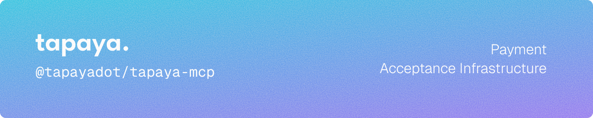

   [](https://docs.tapaya.com) [](LICENSE)

Model Context Protocol server for the Tapaya documentation and REST API. Connects any MCP client (Claude Code, Cursor, VS Code, Claude Desktop) to search the docs and explore the API without leaving your editor.

## Install

Claude Code:

```bash
claude plugin marketplace add tapayadot/tapaya-mcp
claude plugin install tapaya-docs@tapaya
```

The server is public and read-only. No API key or secret is required.

## Requirements

- An MCP client that supports remote Streamable HTTP servers.
- Network access to `https://docs.tapaya.com/mcp`.

There is no local runtime and no build step. The plugin only registers a remote server.

## Other clients

Cursor (`~/.cursor/mcp.json`):

```json
{
  "mcpServers": {
    "tapaya-docs": {
      "url": "https://docs.tapaya.com/mcp"
    }
  }
}
```

VS Code (`.vscode/mcp.json`):

```json
{
  "servers": {
    "tapaya-docs": {
      "type": "http",
      "url": "https://docs.tapaya.com/mcp"
    }
  }
}
```

Claude Desktop (MCP config):

```json
{
  "mcpServers": {
    "tapaya-docs": {
      "url": "https://docs.tapaya.com/mcp"
    }
  }
}
```

One-click "Install in Cursor" and "Install in VS Code" links are on the docs page: [docs.tapaya.com/mcp-server](https://docs.tapaya.com/mcp-server).

## Tools

The server exposes five read-only tools.

| Tool | Purpose |
| --- | --- |
| `search_docs` | Full-text search across all documentation pages |
| `get_page` | Fetch the full Markdown of a page by its url |
| `list_pages` | List every page as title, url, and description |
| `search_api_endpoints` | Search the Tapaya REST API by keyword |
| `get_api_endpoint` | Full parameters and responses for one endpoint |

## What it connects to

A single remote MCP server at `https://docs.tapaya.com/mcp` over Streamable HTTP. Nothing runs locally; the plugin points your client at that endpoint.

## Notes and safety

- Read-only: the server never calls the live Tapaya API and never asks for keys or secrets.
- When combining multiple MCP servers, use the usual caution around prompt injection from tool output, and enable human confirmation for tools where your client supports it.

## Repository layout

- `.claude-plugin/marketplace.json` defines the `tapaya` marketplace.
- `plugins/tapaya-docs/` is the plugin: a `.mcp.json` declaring the remote Streamable HTTP server, plus its manifest and README.

## Documentation

Full documentation is available at [docs.tapaya.com](https://docs.tapaya.com). MCP setup lives at [docs.tapaya.com/mcp-server](https://docs.tapaya.com/mcp-server).

## License

Licensed under the [Apache License, Version 2.0](LICENSE).
